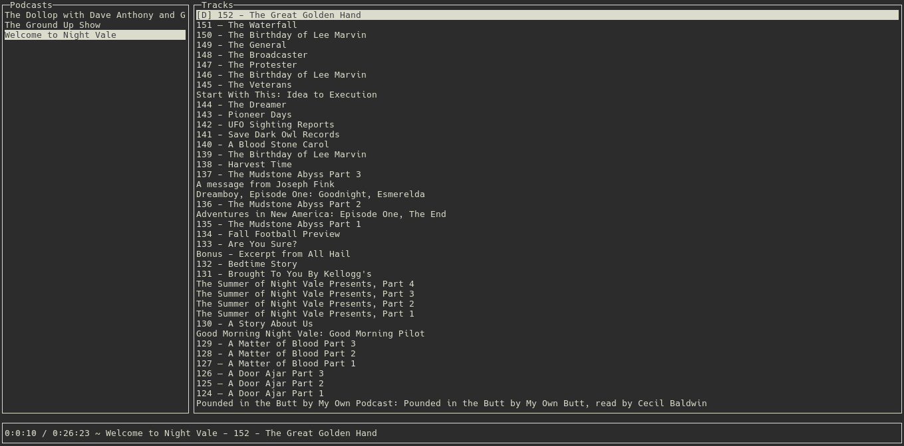

# Podgo

[](https://github.com/ugoturner/podgo/actions/workflows/ci.yml)
[](https://goreportcard.com/report/github.com/ugoturner/podgo)
[](./LICENSE)

**Podgo** is a terminal-based app for managing and playing podcasts. It uses the [Gocui](https://github.com/jroimartin/gocui) library, wrapped in a custom-built layer called [Songocui](https://github.com/UgoTurner/songocui), and handles feed parsing with [Gofeed](https://github.com/mmcdole/gofeed).



## Requirements

- **Go 1.25+**
- **ALSA development headers** (Linux) for audio playback:
  ```bash
  sudo apt-get install -y libasound2-dev   # Debian / Ubuntu
  ```

## Installation

### With `go install`

The configuration is embedded in the binary, so podgo can be installed once and
run from any directory:

```bash
go install github.com/ugoturner/podgo@latest
podgo
```

### From source

```bash
git clone https://github.com/ugoturner/podgo.git
cd podgo
make deps    # install ALSA headers (Debian/Ubuntu)
make build   # or: go build -o podgo .
./podgo
```

## Data locations

Podgo stores its data under the standard per-user directories, so nothing is
written to the working directory:

| Data              | Location (default)                                       |
|-------------------|----------------------------------------------------------|
| Downloaded tracks | `$XDG_CACHE_HOME/podgo/tracks` (`~/.cache/podgo/tracks`) |
| Feed database     | `$XDG_DATA_HOME/podgo/db` (`~/.local/share/podgo/db`)    |
| Log files         | `$XDG_DATA_HOME/podgo/logs` (`~/.local/share/podgo/logs`) |

## Development

```bash
make test        # run the test suite
make test-cover  # run tests with coverage
make fmt         # format the code
make vet         # run go vet
make lint        # run golangci-lint
```

## Project layout

| Path        | Responsibility                                              |
|-------------|-------------------------------------------------------------|
| `cmd/`      | Application wiring and bootstrap (`Build`)                   |
| `handler/`  | Maps TUI events to actions (the `App` subscriber)           |
| `service/`  | Feed parsing, downloading and audio playback                |
| `model/`    | Domain types and the Scribble-backed repository             |
| `conf/`     | Constants, runtime paths and the embedded panel/key config  |

## Usage

### Layout
The terminal is divided into three panels:
1. **Podcasts list (side panel)**: Displays the user's saved podcasts.
2. **Tracks list (main panel)**: Shows the track list for the selected podcast.
3. **Summary (footer panel)**: Contains the player and shows prompts when actions are required.

### Key bindings

Key combination | Description
---|---
<kbd>&uarr; and &darr;</kbd>|Navigate up and down in the list views
<kbd>&rarr;</kbd>|Enter into the next view
<kbd>Ctrl</kbd>+<kbd>a</kbd>|Add new podcast feed (then <kbd>Enter</kbd> to confirm it)
<kbd>Ctrl</kbd>+<kbd>d</kbd>|Download the selected track
<kbd>Ctrl</kbd>+<kbd>p</kbd>|Play (and download if it is not done yet) the selected track
<kbd>Ctrl</kbd>+<kbd>space</kbd>|Toggle play/pause
<kbd>Ctrl</kbd>+<kbd>f</kbd>|Seek forward
<kbd>Ctrl</kbd>+<kbd>b</kbd>|Seek backward
<kbd>Ctrl</kbd>+<kbd>c</kbd>|Exit Podgo
